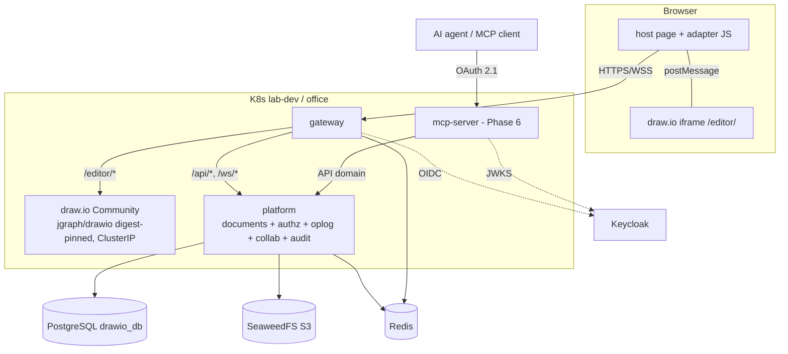

# MASTER-PLAN — draw.io Community + drawio-custom-service

Author / Agent: Claude Code
Timestamp: 2026-10-25 01:25 (revisi besar 2026-10-25 03:10 setelah SPIKE-002)
Status: Architecture review putaran 2 — **APPROVED WITH CONDITIONS** · Jawaban Phase 1: **GO WITH CONDITIONS** (bagian terakhir). Belum ada kode produksi.

## Status Phase 1 (diperbarui 2026-10-25, Claude Code) — **PHASE 1 — PASS WITH CONDITIONS** (lab LIVE, Synced/Healthy)
Phase 1 = deploy draw.io resmi tanpa modifikasi. **Tidak ada perubahan arsitektur**; semua hipotesis (kolaborasi, adapter↔semantic-op, S3, Redis, MCP, AI) tetap seperti tabel keputusan (Phase 5 tetap terkunci).

**Kebijakan image (sumber kebenaran: bagian ini + `helm-values-lab/lab-manifest/drawio/values-env-dev.yaml`)**
| Item | Nilai |
|---|---|
| Sumber | `docker.io/jgraph/drawio:32.6.1` (resmi, tanpa modifikasi), dirilis 2026-10-23 |
| Index digest (immutable, yang dipin) | `sha256:3d0a5a5ffb4f76abcecd9d17ae1373e3eefd0db07b657c545637dc9c6a7412e1` |
| linux/amd64 | `sha256:71d6ada4e11b163ff50593d8773b45a507e8b151a5ef74bd1da5298f03f62c94` |
| linux/arm64 | `sha256:693feb8978db554291793a8d0bd99f1055ffe3477ff6c0c7c60817e5acb38803` |
| Mirror Harbor lab | `harbor.lab.local/drawio/drawio:32.6.1` (project `drawio`, publik di lab seperti project n8n; salinan `crane copy`, digest index identik setelah promosi — diverifikasi) |
| **Pengecualian eksplisit** | **Umur minimum image ≥ 2 minggu DILANGGAR atas persetujuan user (2026-10-25)**: 32.6.1 baru berumur 2 hari. Alasan: satu-satunya kandidat dengan bukti lengkap; Trivy hanya 4 HIGH `pebble` (komponen ACME tak dipakai) di arm64 dan amd64. 32.3.0 (umur 18 hari) **ditolak**: tambahan 2 HIGH di paket OS `curl`/`libcurl4t64` CVE-2026-92392. 32.4.1 tidak ditunggu. |
| Upgrade | tag + digest baru → ulangi matriks hardening, Trivy, smoke `/editor/` (ADR-0012) |

**Bukti lab (EVIDENCE, 2026-10-25)**: pod `lab-dev` Ready, imageID = digest di atas, uid 1001/gid 0, semua capability kosong, `NoNewPrivs`, seccomp RuntimeDefault, tanpa hostPath/SA token, log bersih; `/editor/` 200, `DRAWIO_*` terpasang (`PreConfig.js`); matriks hardening arm64+amd64(emulasi) PASS, GID≠0 melewati `DRAWIO_*` senyap (dikonfirmasi ulang); Chrome headless (Mac) via vhost uji: editor init, buat/edit/hapus/undo/redo shape, round-trip XML, reload, **0 request keluar `drawio.lab.local`**, 0 pelanggaran CSP. **Chrome asli / inspeksi visual manual: PASS** — dilakukan user pada Chrome asli (profil `claude`) lewat vhost+Ingress uji sementara, bukan hanya Chrome headless: UI/toolbar/sidebar/canvas normal, buat/edit shape dan interaksi diagram dicoba, tanpa masalah visual; "Unsaved changes" expected (persistensi bukan scope Phase 1). Akses sementara sudah dihapus (tidak ada ingress/vhost draw.io permanen; `drawio.lab.local` kembali jatuh ke vhost default ArgoCD, expected).

**Kondisi yang membuat Phase 1 = PASS WITH CONDITIONS (bukan PASS penuh):**
1. RHEL/RKE office AMD64 masih **UNVERIFIED**.
2. Validasi AMD64 di lab memakai **emulasi** (Docker Desktop), bukan AMD64 fisik/kantor.
3. Persistensi dokumen / save-to-server **bukan scope Phase 1** (hanya perangkat/XML).
4. Kolaborasi tetap gate Phase 5.
5. Integrasi adapter ↔ semantic operation tetap **belum terbukti** (SPIKE-003).
6. **Phase 2 dan Phase 5 tetap LOCKED.**

**RHEL/RKE kantor (AMD64): UNVERIFIED** (belum diuji; langkah di `lab/docs/office-sync/DRAWIO-PHASE1-OFFICE-STEPS.md`). Penyimpanan/save ke server TIDAK ada di Phase 1 (hanya perangkat/XML).

Label bukti: **EVIDENCE** (dijalankan/dibaca, hasil tercatat) · **INFERENCE** · **UNKNOWN/UNVERIFIED**. Definisi di `docs/adr/README.md`.

## Keputusan user: program lab-first (2026-10-25, tercatat Claude Code) — tidak mengubah arsitektur/ADR
1. **Lab dulu sampai end-to-end terbukti; kantor/RHEL/RKE AMD64 tidak disentuh** dan tetap **UNVERIFIED**. Pengesampingan eksplisit user atas gate "Phase 2 setelah smoke Phase 1 lulus di lab **dan kantor**" **hanya untuk pekerjaan lab**; smoke kantor tetap wajib sebelum apa pun dideploy ke kantor.
2. Urutan fase dan gate lain **tidak** dilonggarkan: Phase 4b (SPIKE-003) adalah gate keras Phase 5; ADR-0010 harus dibekukan (schemaVersion 1) sebelum Phase 5; bila SPIKE-003 gagal, Phase 5 berhenti (fallback snapshot + lock).
3. Build/CI image custom: repo `Glhby13/drawio-custom-service` (remote `origin` ada, masih kosong) memakai pola Jenkins multibranch + Kaniko → Harbor seperti `n8n-custom-service`; setiap `git push` tetap menunggu persetujuan eksplisit user.
4. Aktor AI di lab dibuktikan dengan **Claude Code sebagai klien MCP** (identitas Keycloak khusus, `actorType=ai`, delegasi). Platform tidak punya dependensi runtime ke API AI mana pun; perilaku agen lain/model on-prem tetap UNVERIFIED.
5. Tidak diwarisi dari n8n-custom-service: `InsecureSkipVerify`, penerimaan ID token tanpa verifikasi JWKS (ADR-0012 §11).

## Status Phase 2 — gateway (2026-10-25, Claude Code): kode + E2E lab LULUS, menunggu persetujuan push GitOps/repo
| Capability | Status | Bukti |
|---|---|---|
| OIDC code + PKCE, verifikasi JWKS (ID + access token), nonce, state sekali pakai, binding cookie | **PROVEN (lab)** | tes handler dengan IdP palsu + E2E Chrome vs Keycloak lab |
| Sesi server-side Redis (idle + absolut), fail-closed | **PROVEN (lab)** | `edge_test.go`; E2E logout/forged cookie |
| Coarse role check; user tanpa role ditolak | **PROVEN (lab)** | E2E `e2e-team2` → 403 tanpa sesi |
| Proxy `/editor/*` tanpa bypass, cookie/Authorization tidak diteruskan | **PROVEN (lab)** | tes + E2E (draw.io ClusterIP tanpa Ingress sendiri) |
| CSP, same-origin, plugin/adapter loading | **PROVEN (lab)** | 0 pelanggaran CSP; handshake "editor ready" |
| Logout menyeluruh (sesi server + SSO Keycloak) | **PROVEN (lab)** | E2E |
| draw.io mati → 502 terlihat, pulih otomatis | **PROVEN (lab)** | E2E |
| Image: Trivy 0 vuln, SBOM CycloneDX, `CGO_ENABLED=0`, non-root, rootfs read-only | **PROVEN (lab, arm64 + amd64 build)** | Trivy/SBOM, `go version -m` |
| Deploy lewat ArgoCD + CI Jenkins | **UNVERIFIED** | menunggu persetujuan push; deploy sementara via kubectl hanya untuk validasi |
| Rate limit | **PARTIAL** | proses-lokal (38/80 → 429); batas ingress = Phase 8 |
| Token internal | **PROVEN (unit)** | belum dipakai service lain (Phase 3) |
Pengesampingan gate kantor Phase 2 dicatat di "Keputusan user: program lab-first". Phase 3 belum dimulai.

## 1. Executive Summary
draw.io Community dipakai **apa adanya** sebagai editor; `drawio-custom-service` adalah lapisan enterprise (SSO, penyimpanan terpusat, izin, versi, kolaborasi, audit, MCP, AI)
yang memakai **satu Semantic Operation Contract** dan **satu pipeline otorisasi domain** untuk manusia dan AI. Lab (MacBook M4 ARM64, cluster RHEL 9.8 aarch64 + RKE2) dan
office (RHEL 9.6/9.8 AMD64, RKE, kemungkinan air-gapped) memakai **kode, kontrak, logika kolaborasi, MCP, dan model persistence yang sama**; perbedaan hanya di build/runtime/deploy (ADR-0011/0012).

Ringkasan bukti (SPIKE-001, SPIKE-002):
- Protokol embed resmi draw.io (`diffSync`/`patch`) adalah batas integrasi yang bekerja tanpa mengubah draw.io; perilaku fungsionalnya **identik** di image arm64 dan amd64 dan di Chrome Mac vs Chromium Linux x86-64.
- Patch native bukan kontrak platform (blob → lost update). Kontrak = Semantic Operation, disimpan dalam bentuk **resolved**, dengan **geometri intent absolut**; terbukti di model Go lewat 12.000 skrip fuzz (1,15 juta op) tanpa pelanggaran, sementara geometri naif menghasilkan 1.661 pelanggaran wrong-intent per 3.000 skrip.
- Checksum kanonik JS↔Go: 174/174 dokumen identik (termasuk dihitung oleh binary Go linux/amd64).
- PostgreSQL op log layak: group commit menopang ±10.000 op/s per dokumen dengan p99 ≈ 8 ms (dev).
- **Belum terbukti:** integrasi adapter ↔ model Go ↔ draw.io, kinerja di server nyata, dan semua yang butuh RHEL/RKE AMD64. Model kolaborasi tetap **hipotesis**.

## 2. Goals
- SSO Keycloak; satu pintu masuk `drawio.lab.local` lewat gateway.
- Diagram tersimpan terpusat (S3 + PostgreSQL), berversi, dapat dipulihkan; tanpa PVC.
- Share/izin per dokumen/folder; audit lengkap.
- Kolaborasi realtime yang konvergen, bermakna (intent terjaga), dan diotorisasi per operasi.
- MCP dan AI memakai jalur yang sama dengan manusia.
- Portable: satu sumber untuk ARM64 dan AMD64; on-prem/air-gapped.

## 3. Non-goals
- Mengubah, mem-fork, atau me-rebuild draw.io.
- Kolaborasi realtime pada diagram sangat besar (> ±1.000 cell nyaman; lihat §21).
- Integrasi cloud bawaan draw.io (dimatikan; editor tidak mencoba akses eksternal — EVIDENCE E11).
- Microservices sebagai tujuan; cabang logika per arsitektur.

## 4. Architecture Principles
1. Non-invasive terhadap draw.io (ADR-0001). 2. Pod stateless, state eksternal (ADR-0002). 3. Authentication = edge, Authorization = domain (ADR-0004).
4. **Semantic Operation Contract = kontrak platform** (ADR-0010). 5. Wire format ≠ domain operation ≠ merge algorithm ≠ persistence format (ADR-0006).
6. Tidak ada jalur belakang (MCP/AI hanya lewat API domain). 7. Keputusan berbasis bukti; hipotesis berstatus Proposed/HYPOTHESIS.
8. **Satu sumber untuk semua arsitektur; perbedaan hanya build/runtime/deploy** (ADR-0011). 9. Bedakan *convergence* ≠ *correctness* ≠ *intent preservation* ≠ *authorization* — keempatnya adalah properti yang diuji terpisah (SPIKE-002 §11).
Prioritas: correctness → arsitektur jelas → bukti → keamanan → operability → performa → kecepatan implementasi.

## 5. System Boundary

Di luar batas: Keycloak, PostgreSQL, SeaweedFS, Redis, VM nginx (TLS edge), Harbor, Jenkins, ArgoCD.

## 6. Deployment Topology
ADR-0003 (tidak berubah). draw.io: `helm-base-lab/drawio`, `helm-values-lab/lab-manifest/drawio/` (3 file), element `- service: drawio` di `lab-projects-dev-lab-services.yaml` (template tidak diubah), ClusterIP.
Custom: chart generik `helm-base-lab/drawio-custom-service`, values `lab-manifest/drawio-custom-service/<svc>/`, AppProject/ApplicationSet `lab-drawio-custom-projects`. Gateway satu-satunya Ingress.
**Tambahan dari bukti:** image draw.io dipin **digest** (`jgraph/drawio@sha256:3d0a5a5f…412e1` untuk 32.6.1; **dipilih final di Phase 1 dengan pengecualian umur yang disetujui user**, lihat Status Phase 1), disalin ke Harbor, `runAsGroup: 0`, rootfs writable, probe `GET /editor/` (ADR-0012).

## 7. Authentication
Gateway: OIDC code+PKCE realm `lab`, sesi Redis, cookie `HttpOnly/Secure/SameSite=Lax`. mcp-server: OAuth 2.1 bearer + Protected Resource Metadata. Token internal berumur pendek (ADR-0004).
CA internal di-mount dan dipercaya; **tanpa `InsecureSkipVerify`** (n8n-custom-service lab memakainya — jangan diwarisi).

## 8. Authorization
Satu PDP domain dipakai REST, collab (join + per op), MCP; peran viewer/commenter/editor/owner, share user/group, pewarisan folder, kebijakan AI. Pencabutan memutus sesi. Dalam model fuzz: 114.015 op ditolak `forbidden` dan 0 op yang dicabut lolos ke log (EVIDENCE). Detail ADR-0004/0009.

## 9. Draw.io Integration
Protokol embed resmi sebagai batas (EVIDENCE E2–E9): `load` dengan `autosave:1, diffSync:{patchOnly:true}`; capture lewat event `autosave{patch,checksum}`; apply lewat action `patch`; repair via adapter diff. `Draw.loadPlugin` dari host same-origin hanya untuk presence/shadow per key. `mxEvent.CHANGE` bukan batas integrasi.
Konfigurasi draw.io hanya lewat env image; webapp identik di arm64/amd64. Editor tidak membuat request eksternal (E11).

## 10. Change Model
Patch native = format lokal adapter (blob `style`/`geometry`/`xmlValue`). Adapter menerjemahkan ke Semantic Operation per key (R2-2, UNVERIFIED). Undo lokal draw.io menghasilkan op LOCAL baru → bisa menimpa edit remote (E9/U2) → undo harus per-actor dan dilaporkan sebagai overwrite.

## 11. Semantic Operation Contract
ADR-0010 (Proposed, direvisi): envelope + jenis op; **bentuk authored vs resolved** (log menyimpan resolved); geometri intent absolut; `reparent` mempertahankan posisi absolut; nack eksplisit untuk setiap op yang tidak diterapkan; event `overridden`; `rebalanceSiblings`; kunci `(pageId, cellId)`.

## 12. Collaboration
ADR-0006 (Proposed — **CURRENT HYPOTHESIS**): hybrid (sequencer server + LWW per key + aturan struktural deterministik + move tervalidasi + fractional index + rebase re-apply + repair + snapshot + op log).
Bukti: S1 relay naif divergen 10/18; S3 15/18; S3+repair 18/18 (draw.io, harness); model Go 12.000 skrip fuzz 0 pelanggaran; OT ditolak; CRDT library ditunda; fallback selalu snapshot + lock. Kriteria penerimaan dan statusnya di ADR-0006.

## 13. Persistence
ADR-0007: snapshot XML gzip di S3 (**belum diuji**), op log + metadata + izin + audit + versi di PostgreSQL (**diuji dev**: 440 B/op; group commit; replay 1 juta op 1,6 s; partisi untuk retensi), Redis non-sumber-kebenaran (**belum diuji**).

## 14. Versioning
Versi bernama = pointer ke `server_seq` + snapshot; restore = op baru (revert memakai `previous_values` di sisi log); kompaksi tidak menyentuh versi bernama.

## 15. MCP
ADR-0008 (Proposed): `mcp-server` terpisah, OAuth 2.1 Keycloak, primitif `apply_operations` + helper pembungkus semantic op, read model ringkasan semantik. Phase 6.

## 16. AI Collaborator
ADR-0009 (Proposed): `actorType=ai`, delegated (izin AI ∩ user) atau service account; presence, atribusi, kebijakan op/rate/batch, revert per batch, tanpa jalur belakang. Phase 7.

## 17. Security
- Edge: OIDC/OAuth, CSRF, origin check WS, rate limit, batas body/frame, `frame-ancestors 'self'`, `DRAWIO_CSP_HEADER` eksplisit.
- Domain: PDP per op; validasi schema + invarian (siklus, referensi, ukuran, kunci urutan valid).
- Input klien tak tepercaya: patch native punya guard prototype pollution (E7: 5 patch hostile tidak merusak editor) — platform tidak mengandalkannya.
- Supply chain: image draw.io Trivy 4 HIGH (semua di `pebble`, komponen tak dipakai); gerbang Trivy + audit CGO di CI custom; digest pin; SBOM/provenance (ADR-0012).
- Container: draw.io butuh GID 0 + rootfs writable (tidak bisa read-only); service custom read-only, uid 65532.

## 18. Observability
Log JSON terstruktur dengan redaksi (pola `n8n-custom-service/internal/httpx`), metrik: op/s per dokumen, latensi authorize/validate/commit/broadcast, nack per kode, overwrite konkuren, repair per jam, koneksi WS, ukuran op log, umur snapshot. Alert: repair rate, commit p99, lag broadcast, nack `forbidden` tak wajar.

## 19. Disaster Recovery
Sumber kebenaran: PostgreSQL + S3. Backup PG (dump harian + WAL bila ada) dan bucket S3; restore: DB ke titik T, verifikasi `snapshots.s3_key` (sha256), fallback snapshot lebih tua + replay. Redis hilang = sesi/presence saja. RPO/RTO: UNKNOWN (ditetapkan dengan kantor). Replay terukur: 1 juta op 1,6 s (dev).

## 20. Testing
Contract test adapter per versi draw.io (suite SPIKE-001/002), unit test aturan merge, **fuzz/property test (korpus fixture dari spike-004)**, conformance checksum CANON-v0 (korpus 174 dokumen sebagai fixture, dijalankan di CI ARM64 dan AMD64), E2E Playwright (arm64 + Chromium x86-64), uji abuse/IDOR, uji restart pod (tanpa PVC), uji DR, matriks securityContext.

## 21. Performance
Terukur (dev, Mac berbagi CPU dengan VM lab):
- draw.io di browser: 500 cell capture 33 ms / apply 28 ms (**PASS target <100 ms**); 5.000 cell 269 / 197 ms (lantai graph murni 117 ms → **target <100 ms tidak realistis**). Batas realtime nyaman ±1.000 cell (INFERENCE interpolasi).
- Server CPU: p99 ≤ 29 µs/op. PostgreSQL: lihat ADR-0007.
- UNKNOWN: VM lab/office, jaringan nyata, p95 end-to-end A→B @500 cell (target <250 ms), multi-replika per dokumen.

## 22. Service Decomposition
ADR-0005 (revisi): **2 deployable (`gateway`, `platform`) sampai Phase 5; `mcp-server` ditambah di Phase 6.** Pisah `platform` hanya bila kriteria terbukti (skala WS, isolasi kegagalan, kepemilikan).

## 23. Lab vs Office
```
                       SAME SOURCE · SAME CONTRACT · SAME TESTS
                                        |
                  +---------------------+---------------------+
                  |                                           |
           LAB (ARM64)                                  OFFICE (AMD64)
   Mac M4 · Docker Desktop · UTM VM                RHEL 9.6/9.8 · RKE (varian?) · Harbor
   lab cluster: RHEL 9.8 aarch64 + RKE2            air-gapped (kemungkinan)
   SELinux Permissive                              SELinux = UNKNOWN
                  |                                           |
                  +----- manifest-list digest promotion ------+
                       (digest sama; arm64+amd64 dalam satu index)
```
| Concern | Lab | Office | Sama? |
|---|---|---|---|
| semantic ops, merge, authz, MCP, checksum, model PG/S3 | kode Go/JS sama | sama | **YA** |
| draw.io webapp (JS) | byte-identik | byte-identik | **YA** |
| Arsitektur image | arm64 | amd64 | TIDAK (build) |
| Node/K8s | RKE2 aarch64 | RKE amd64 | TIDAK (deploy) |
| Registry | Harbor lab | Harbor kantor, air-gapped | SEBAGIAN |
| Ingress/TLS/Keycloak endpoint | values lab | values kantor | TIDAK (konfigurasi) |

## 24. Roadmap dan rencana implementasi per fase
Urutan baseline dipertahankan; **perubahan dari bukti:** (a) Phase 4b (paralel dengan 2–4): menyelesaikan SPIKE-003 integrasi sebagai prasyarat Phase 5; (b) Phase 1 menambah smoke wajib di cluster kantor sebelum Phase 2 bergantung padanya; (c) `mcp-server` baru di Phase 6.
Setiap fase: **approval → implementasi → test → hardening → izin push** (push hanya dengan izin eksplisit user).

### Phase 0 — Arsitektur + spike (selesai; dokumen ini)
Objective: bukti arsitektur. Hasil: SPIKE-000/001/002, ADR 0001–0012. Rollback: n/a (dokumen).

### Phase 1 — draw.io GitOps baseline
- **Objective:** draw.io Community berjalan, tanpa kode custom. **Scope:** `helm-base-lab/drawio`, `lab-manifest/drawio/` (3 values), `- service: drawio` di ApplicationSet (template tidak diubah); ClusterIP; tanpa ingress; tanpa PVC.
- **Dependencies:** persetujuan user atas dokumen ini; pemilihan tag + digest (umur ≥ 2 minggu); salinan image ke Harbor lab.
- **Tasks:** chart minimal (Deployment/Service/SA); values: `DRAWIO_SERVER_URL`/`BASE_URL` = `https://drawio.lab.local/editor/`, `DRAWIO_CSP_HEADER` eksplisit tanpa domain cloud, `securityContext` (`runAsUser` bebas, `runAsGroup: 0`, `allowPrivilegeEscalation:false`, `capabilities.drop:[ALL]`, `seccompProfile: RuntimeDefault`, rootfs writable), `emptyDir /tmp`, resource requests/limits, probe `GET /editor/`; element ApplicationSet; dokumen langkah kantor.
- **Tests:** `helm lint/template`; pasca-deploy: Application Synced/Healthy; `kubectl port-forward` → `/editor/` 200; `curl` PreConfig berisi base URL (bukan default); pod restart tidak kehilangan apa pun; ArgoCD aplikasi lain tidak berubah; **smoke di cluster kantor** (daftar §SPIKE-002 §18).
- **Acceptance:** pod Ready dengan securityContext di atas; `/editor/` 200 dan konfigurasi `DRAWIO_*` terpasang; scan Trivy tanpa HIGH/CRITICAL baru selain `pebble`; image dari Harbor internal.
- **Rollback:** hapus element ApplicationSet (revert commit), `prune` tidak aktif → hapus Application/resources manual; tidak ada state.
- **Risks:** silent-skip `DRAWIO_*` bila GID≠0 (probe `/editor/` menangkap); SELinux enforcing di kantor; perubahan digest upstream.

### Phase 2 — Gateway
- **Objective:** satu-satunya ingress `drawio.lab.local` dengan OIDC; proxy `/editor/`. **Scope:** kerangka repo (Go, `CGO_ENABLED=0`, Dockerfile multi-arch), `gateway`, Keycloak client, Harbor project, Jenkins job, vhost nginx, chart generik + ApplicationSet `lab-drawio-custom-projects`.
- **Dependencies:** Phase 1 sehat; ADR-0004 token internal disetujui. **Tasks:** OIDC code+PKCE, sesi Redis, CSRF, proxy `/editor/*` tanpa strip, header `frame-ancestors 'self'`, host page statis; CI: lint/test/govulncheck/Trivy/audit CGO, build multi-arch.
- **Tests:** E2E login (Chrome + Chromium x86-64), user tanpa role ditolak, logout menyeluruh, WebSocket upgrade lewat ingress, uji abuse dasar. **Acceptance:** login → editor termuat; tidak ada akses langsung ke draw.io tanpa gateway. **Rollback:** revert element ApplicationSet; ingress lama tidak ada. **Risks:** CA internal, jam node, timeout WS di ingress kantor.

### Phase 3 — Document service (snapshot + lock)
- **Objective:** simpan/buka diagram terpusat tanpa kolaborasi. **Scope:** `platform` (documents, snapshot S3, metadata PG, versi, mode lock), adapter host page mode snapshot (event `autosave` XML).
- **Tasks:** skema PG + migrasi + `schema_version`, bucket + identitas S3 khusus, REST dokumen, versi bernama, lock editor tunggal, kompaksi snapshot. **Tests:** buat→simpan→muat→restore; restart pod (tanpa PVC); recovery S3 hilang→snapshot lama; uji S3/Redis klien di arm64+amd64 (menutup UNVERIFIED matriks). **Acceptance:** diagram bertahan restart semua pod. **Rollback:** feature flag; data dapat diekspor sebagai XML `.drawio` standar. **Risks:** konsistensi S3↔PG, ukuran XML besar.

### Phase 4 — Permissions & sharing
- **Objective:** PDP domain penuh. **Scope:** peran, share user/group, pewarisan folder, admin, audit. **Tests:** matriks izin, IDOR/abuse (pola `portal-platform/scripts/security/test_api_abuse.py`), pencabutan memutus sesi. **Acceptance:** 0 akses tanpa izin di uji abuse. **Rollback:** migrasi balik. **Risks:** pewarisan folder kompleks.

### Phase 4b (paralel 2–4) — SPIKE-003: integrasi kolaborasi (gate Phase 5)
- **Objective:** membuktikan atau menolak ADR-0006 pada integrasi nyata. **Scope (disposable):** model Go sebagai sumber kebenaran + penerjemah patch↔semantic op (R2-2) + checksum CANON-v0 server + draw.io di loop.
- **Tasks:** round-trip XML→model→XML pada ≥ 20 diagram nyata (termasuk terkompresi); contract test semua jenis op E2; fuzz tingkat integrasi (3–5 klien draw.io sungguhan atau harness patch) ≥ 10.000 urutan; edit in-place/caret; undo per-actor; p95 A→B di lab; benchmark PG di VM lab.
- **Acceptance:** kriteria ADR-0006 tabel status semuanya PASS; bila tidak → Accepted alternative (snapshot+lock, atau CRDT library). **Rollback:** buang spike. **Risks:** adapter lebih rumit dari perkiraan; kinerja draw.io pada diagram besar.

### Phase 5 — Collaboration
- **Gate:** SPIKE-003 PASS + ADR-0006 Accepted (atau alternatif) + ADR-0010 dibekukan (`schemaVersion` 1). **Scope:** `platform` collab (WS, sequencer, op log, presence, rebase, repair, event `overridden`, `rebalanceSiblings`), adapter dua arah.
- **Tests:** konvergensi 3–5 klien nyata, fuzz regresi (fixture), reconnect/offline, permission revoke mid-session, restart platform saat sesi aktif, p95 A→B. **Acceptance:** tidak ada lost update beda-key; overwrite konkuren dinotifikasi; replay = state. **Rollback:** feature flag → mode lock. **Risks:** divergensi di produksi (repair), performa >1.000 cell.

### Phase 6 — MCP
- **Gate:** kontrak op stabil. **Scope:** `mcp-server` (deployable ke-3), OAuth 2.1, tools (`apply_operations` primitif, helper pembungkus), read model semantik. **Tests:** MCP conformance, authz parity dengan REST/WS (matriks yang sama), tidak ada kredensial DB/S3 di pod. **Acceptance:** perubahan agen muncul realtime di editor user dengan atribusi. **Rollback:** nonaktifkan route MCP. **Risks:** spesifikasi MCP berubah; export server-side tidak ada.

### Phase 7 — AI collaborator
- **Scope:** `actorType=ai`, delegasi, kebijakan, presence, revert per batch, quota. **Tests:** izin efektif = irisan, rate limit, aksi destruktif massal butuh konfirmasi server, revert, audit lengkap. **Rollback:** kebijakan workspace "AI off". **Risks:** model on-prem (UNKNOWN), banjir op.

### Phase 8 — Hardening
- NetworkPolicy, rate limit, Trivy/SBOM/signing, DR drill, uji RHEL/RKE enforcing + air-gapped import, benchmark ulang di VM PG office, uji multi-replika, load test, pen-test abuse (pola `lab/security-tools`). **Acceptance:** checklist SPIKE-002 §18 tuntas di office.

## 25. Risks
| Risiko | Dampak | Mitigasi |
|---|---|---|
| Protokol embed/format diff berubah di rilis draw.io | adapter rusak | pin digest; contract test per upgrade; adapter kecil |
| `EditorUi`/`Draw.loadPlugin` internal berubah | presence/shadow rusak | batasi pemakaian; degradasi tanpa presence |
| Integrasi adapter↔model Go lebih sulit dari model murni | Phase 5 tertunda/berubah | Phase 4b gate; fallback snapshot+lock |
| Undo/edit in-place menimpa edit remote | wrong intent | event `overridden`, undo per-actor |
| Lost update/niat salah pada operasi struktural | data user hilang | intent absolut, op resolved, nack eksplisit |
| draw.io senyap melewati konfigurasi (GID≠0/rootfs RO) | path salah | securityContext + probe `/editor/` + uji kontrak |
| Perbedaan RHEL/RKE office (SELinux, runtime, CNI) | deploy gagal di kantor | smoke Phase 1 di kantor; ADR-0012 |
| Performa draw.io O(N) (lantai 117 ms @5.000) | lag | batas realtime ±1.000 cell; mode lock |
| Sequencer multi-replika | urutan ganda | transaksi PG per dokumen; uji Phase 8 |
| Pertumbuhan op log (440 B/op) | disk | partisi + retensi |
| Fractional index memanjang | kunci besar | `rebalanceSiblings` |
| Air-gapped: model AI, mirror image | AI/deploy tertunda | AI opsional; mirror Harbor |

## 26. Open Questions
1. Round-trip XML↔model Go pada diagram nyata terkompresi; checksum CANON-v0 vs fitur jarang.
2. Penerjemah patch native ↔ semantic op per key (nilai lama dari shadow adapter).
3. Versi RKE kantor (RKE1/Docker vs RKE2/containerd), SELinux mode, CNI.
4. RPO/RTO dan retensi audit kantor. 5. Export server-side (PNG/PDF) tanpa export server.
6. Mode "saran" AI (cabang dokumen?). 7. Komentar: model data. 8. Caret/seleksi teks saat patch remote.
9. Performa PG di VM lab/office. 10. Klien S3/Redis di kedua arsitektur (belum ada kode).

## 27. ADR index dan Spike index
ADR: 0001 non-invasive (Accepted) · 0002 stateless (Accepted) · 0003 topologi (Accepted) · 0004 authn/authz (Accepted) · 0005 dekomposisi (Accepted provisional, direvisi) · 0006 kolaborasi (**Proposed**) · 0007 persistensi (Accepted struktur PG) · 0008 MCP (Proposed) · 0009 AI (Proposed) · 0010 Semantic Operation Contract (**Proposed**, direvisi) · 0011 lintas-platform (Accepted invarian) · 0012 build/runtime (Accepted build).
Spike: SPIKE-000 image & embed · SPIKE-001 change model (dikoreksi) · SPIKE-002 lintas-platform + fuzz + checksum + PG · prototipe di `spikes/` (spike-001 harness browser, 002-oplog, 003-checksum, 004-fuzz, 005-pg, 006-crossbuild).

---

## Status Matrix
| Decision | Status |
|---|---|
| draw.io unmodified | **ACCEPTED** |
| plugin adapter (host-injected `Draw.loadPlugin`) | **ACCEPTED** (dengan contract test per versi) |
| semantic operations | **ACCEPTED** sebagai pendekatan; kontrak (ADR-0010) **Proposed** |
| native draw.io diff/patch | **ACCEPTED** sebagai format *lokal adapter* saja (bukan wire/persistensi) |
| CRDT-style semantics | **HYPOTHESIS** (kuat di model; belum di integrasi) |
| OT | **REJECTED** |
| XML merge | **REJECTED** |
| PostgreSQL op log | **ACCEPTED** (struktur; angka diulang di VM lab/office) |
| S3 snapshot | **HYPOTHESIS** (belum diuji) |
| Redis presence | **HYPOTHESIS** (belum diuji) |
| MCP architecture | **HYPOTHESIS** |
| AI collaborator | **HYPOTHESIS** |
| service decomposition | **HYPOTHESIS** (2 deployable → 3 di Phase 6) |
| ARM64 support | **PROVEN** (untuk komponen yang ada) |
| AMD64 support | **PARTIAL** (fungsional via emulasi + Chromium x86-64; kinerja/RHEL belum) |
| RHEL 9.x | **UNVERIFIED** (hanya fakta OS lab aarch64 terbaca; tidak ada workload kita di RHEL) |
| RKE | **UNVERIFIED** (RKE2 lab terbaca; RKE kantor UNKNOWN) |

## Architecture Review Decision
**Status: APPROVED WITH CONDITIONS** (2026-10-25, Claude Code; menunggu persetujuan eksplisit user)

### Approved
- Prinsip non-invasive dan batas integrasi embed resmi; webapp identik antar arsitektur (EVIDENCE).
- Pod stateless, topologi GitOps, authn edge / authz domain, kontrak operasi tunggal untuk manusia/AI/MCP.
- Penolakan XML merge dan OT; hybrid sebagai hipotesis yang sangat kuat di model.
- Arsitektur portable ARM64 ↔ AMD64 dengan satu sumber (ADR-0011) dan kebijakan build/runtime (ADR-0012).
- PostgreSQL append-only op log (struktur) dan checksum kanonik CANON-v0.

### Conditions
1. Phase 1 hanya setelah digest + securityContext + probe `/editor/` + mirror Harbor ditetapkan; **smoke di cluster kantor** sebelum Phase 2.
2. ADR-0010 revisi (resolved op, intent absolut, `overridden`, `rebalanceSiblings`) disetujui sebelum kode kontrak ditulis.
3. Phase 5 tidak dimulai sebelum Phase 4b/SPIKE-003 lulus.
4. Tidak ada klaim "berjalan di office/RHEL/RKE" tanpa uji di sana; setiap fase: approval → implementasi → test → hardening → izin push.

### Open Questions
Lihat §26.

### Decision Gate
| Gate | Bukti |
|---|---|
| Phase 1 | persetujuan user + kondisi 1 |
| Phase 2 | smoke Phase 1 lulus di lab **dan** kantor; ADR-0004 token internal disetujui |
| Phase 5 | SPIKE-003: tabel kriteria ADR-0006 semua PASS; CANON-v0 conformance di CI kedua arsitektur; benchmark PG di VM lab |
| Phase 6 | `schemaVersion` 1 dibekukan; read model semantik tersedia |

## Final Question

> **Apakah architecture drawio-custom-service saat ini sudah cukup kuat untuk mulai Phase 1, dengan development di Mac M4 ARM64 dan target deployment office RHEL 9.x/RKE AMD64?**

### **GO WITH CONDITIONS**

Phase 1 hanya men-deploy draw.io resmi tanpa kode custom, sehingga tidak bergantung pada hipotesis kolaborasi; semua yang menyentuh Phase 1 sudah dibuktikan (image multi-arch, webapp identik, hardening, subpath, tanpa Internet, scan, promosi digest). Syarat, berdasarkan severity:

| Sev | Item | Dibutuhkan sebelum |
|---|---|---|
| **P0** (blocker arsitektur) | tidak ada untuk Phase 1–4. **P0-A:** integrasi adapter↔model Go↔draw.io belum terbukti (model kolaborasi masih hipotesis) — gate **Phase 5** | Phase 5 |
| **P1** (blocker implementasi) | (1) digest pin + mirror Harbor + `runAsGroup:0`, rootfs writable, probe `/editor/`; (2) smoke di RHEL/RKE AMD64 kantor (SELinux, runtime, CNI, ingress); (3) persetujuan ADR-0010 revisi; (4) penerjemah patch↔op (R2-2), round-trip korpus nyata, fuzz integrasi; (5) event `overridden` + undo per-actor | (1)(2): Phase 1–2; (3): Phase 2; (4)(5): Phase 5 |
| **P2** (hardening/optimasi) | benchmark PG di VM lab/office; partisi `ops`; batas realtime ±1.000 cell didokumentasikan; Trivy/SBOM/signing di CI; klien S3/Redis diuji; multi-replika sequencer; caret test; RPO/RTO | Phase 3–8 |
| **P3** (dokumentasi) | tracking lab↔office `lab/docs/office-sync/DRAWIO-CUSTOM-SERVICE-OFFICE-VS-LAB.md`, README, catatan agent | Phase 1 |
