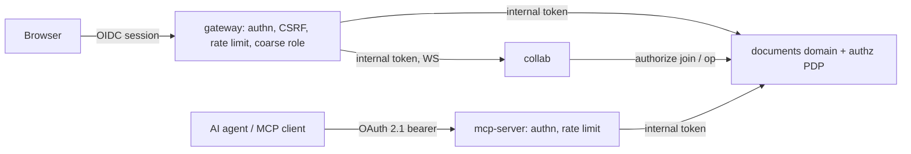

# ADR-0004 — Autentikasi di edge, otorisasi di domain

Author / Agent: Claude Code
Timestamp: 2026-10-25 00:10
Status: Accepted

## Context
Ada empat jalur masuk ke data diagram: REST (UI), WebSocket kolaborasi, MCP (agen), dan AI (di atas MCP/API). Bila tiap jalur
punya logika izin sendiri, aturan akan menyimpang dan muncul jalur belakang. Prinsip: **Authentication = edge, Authorization = domain.**

## Decision
### Edge (gateway untuk browser, mcp-server untuk agen)
- OIDC Keycloak realm `lab` (browser: authorization code + PKCE, sesi server-side di Redis, cookie `HttpOnly; Secure; SameSite=Lax`;
  agen: OAuth 2.1 bearer token, validasi `iss`/`aud`/`exp`/signature via JWKS).
- CSRF (double-submit / origin check) untuk REST yang mengubah data; origin check untuk upgrade WebSocket.
- Rate limit, batas ukuran body/frame WebSocket, routing, header keamanan (`frame-ancestors 'self'`, CSP gateway).
- **Coarse check saja**: token valid + punya client role aplikasi (`drawio-lab: user|admin`). Edge **tidak** tahu dokumen apa yang boleh dibuka.
- Edge menerbitkan **token internal** berumur pendek (≤ 5 menit, ditandatangani kunci edge, `aud` per service) berisi
  `sub`, `actorType` (`human|ai|service`), `onBehalfOf`, `roles`, `sessionId`, `agent`/`model` bila AI. Service internal menolak
  request tanpa token internal yang valid; header identitas polos tidak pernah dipercaya.

### Domain (modul `authz` milik bounded context documents)
- Satu **policy decision point** (library Go internal + tabel izin di PostgreSQL) dipakai oleh REST handler, collab (join + setiap op),
  dan MCP. Pertanyaan yang dijawab: read, comment, edit, apply-operation(type), share, delete, restore, export, manage-AI-policy.
- Model izin awal: pemilik, share per dokumen/folder ke user atau Keycloak group dengan peran `viewer|commenter|editor|owner`,
  pewarisan folder → dokumen, admin aplikasi melihat semua. Kebijakan workspace untuk AI (ADR-0009).
- Otorisasi **per operasi**: `apply-operation` dicek per jenis op (mis. viewer menolak semua mutasi; kebijakan bisa melarang
  `deleteCell` massal oleh AI).
- Pencabutan izin dipublikasikan sebagai event; collab memutus sesi yang tidak lagi berhak.

## Consequences
- Gateway dan mcp-server bisa diganti/diskalakan tanpa menyentuh aturan izin.
- Collab tidak menyimpan aturan izin; ia memanggil PDP (in-process bila collab dan documents satu deployable, RPC bila terpisah — ADR-0005).
- Setiap keputusan deny/allow yang mengubah data dicatat di audit (ADR-0007).
- Latensi cek izin per op harus kecil (cache keputusan per sesi+dokumen dengan invalidasi via event) — diukur di Phase 5.

## Alternatives
- Izin di gateway (path-based) — ditolak: tidak tahu dokumen/op; jalur MCP akan menduplikasi.
- Keycloak Authorization Services (UMA) sebagai PDP — ditunda: kompleks, latensi per op; bisa dievaluasi untuk share lintas aplikasi.
- OPA/Rego sidecar — ditunda: menambah komponen; kebijakan awal cukup sederhana untuk Go.

## Evidence
INFERENCE (desain). Pola OIDC yang sudah jalan di lab: `n8n-custom-service/internal/authservice/oidc.go`. Diverifikasi di Phase 2/4 (uji IDOR/abuse).

## Addendum implementasi Phase 2 (2026-10-25, Claude Code) — tidak mengubah keputusan
- Token internal: JWS kompak **EdDSA (Ed25519)**, header `kid`, klaim `iss=drawio-gateway`, `sub`, `aud` (per service), `actorType`, `onBehalfOf`, `roles`, `sessionId`, `agent`, `model`, `iat`, `exp`, `jti`; TTL **≤ 5 menit** ditegakkan saat tanda tangan dan saat verifikasi; `alg`/`kid`/`aud`/`iss` diperiksa ketat (token `alg=none` ditolak). Kunci privat = seed 32 byte di Secret gateway; kunci publik diberikan ke service internal (Phase 3). Kode: `internal/identity`.
- Sesi: cookie `__Host-drawio_sid` (HttpOnly, Secure, SameSite=Lax, Path=/) berisi id acak 256-bit; data di Redis `drawio:sess:<sha256(id)>` (dump Redis tidak dapat dipakai ulang sebagai cookie); idle 30 menit (bergulir) dan batas absolut 8 jam; Redis mati = gagal tertutup (503).
- Login: state sekali pakai (`GETDEL`), nonce, PKCE S256, dan cookie pengikat browser (anti login-CSRF); `return_to` hanya path relatif.
- Peran kasar: client role `user|admin` di client `drawio-lab`; tanpa role = 403 dan tidak ada sesi. Gateway **bukan** sumber kebenaran izin dokumen.
- EVIDENCE: `internal/edge/edge_test.go` (matriks + 12 mutasi kontrol keamanan terdeteksi), `e2e/phase2_gateway.mjs` (24/24 di Chrome terhadap Keycloak lab).
